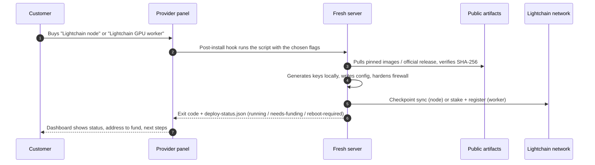
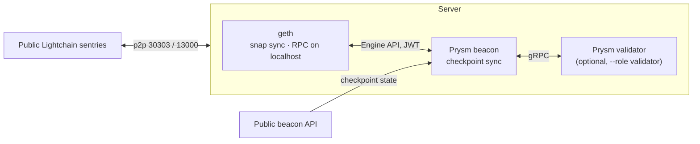
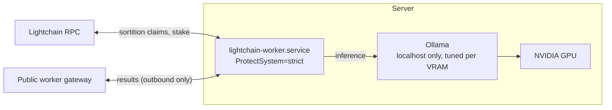

<h1 align="center">Lightchain Rails</h1>

<p align="center"><strong>One click from a bare server to a paid seat on the Lightchain network.</strong></p>

<p align="center">
Two scripts. No runbook. No keys in transit. A hosting provider wires them into a post-install hook,<br>
a customer picks <em>node</em> or <em>GPU worker</em> at checkout, and the machine is earning or validating when they first log in.
</p>

<p align="center">
<a href="#quick-start">Quick start</a> ·
<a href="#what-the-customer-gets">What the customer gets</a> ·
<a href="#for-hosting-providers">For hosting providers</a> ·
<a href="#security-model">Security model</a> ·
<a href="#day-two">Day two</a> ·
<a href="#reference">Reference</a>
</p>

---

## The two rails

| | `deploy-node.sh` | `deploy-worker.sh` |
|---|---|---|
| **Produces** | A synced Lightchain node: geth execution client + Prysm beacon node. Optional validator client. | A Lightchain inference worker: NVIDIA driver, Ollama, the official worker binary, on-chain registration. |
| **Earns by** | Validating (with a 500,000 LCAI stake per key) or serving RPC to your own apps. | Running AI inference jobs claimed through sortition. Paid per job. |
| **Hardware** | 4 vCPU · 16 GB RAM · 200 GB NVMe · 100 Mbit · public IPv4 | NVIDIA GPU with 8 GB+ VRAM (L4 / 4090 class recommended) · 8 vCPU · 32 GB RAM · 100 GB NVMe |
| **Inbound ports** | SSH + p2p (30303, 13000, 12000) | SSH only |
| **Time to live** | Beacon at head in minutes, execution layer in 10 to 60 | Driver reboot + model pull, then live on funding |

Both scripts are **idempotent**: run them again to re-apply, to continue after a reboot, or to pick up a new flag. Both target Ubuntu 22.04 and 24.04, run as root, and need outbound HTTPS only. Every run preflights the machine, logs to `/var/log/lightchain-deploy.log`, locks against a concurrent run, retries flaky downloads, and leaves a machine-readable result in `/etc/lightchain/deploy-status.json`.

## Quick start

Node on mainnet:

```bash
curl -fsSL https://raw.githubusercontent.com/lightchain-protocol/lightchain-rails/main/deploy-node.sh | bash -s -- --network mainnet
```

GPU worker on mainnet serving `llama3-8b`:

```bash
curl -fsSL https://raw.githubusercontent.com/lightchain-protocol/lightchain-rails/main/deploy-worker.sh | bash -s -- --network mainnet --models llama3-8b --auto-reboot
```

`--auto-reboot` lets the worker script reboot by itself after the NVIDIA driver install and resume on its own. Leave it off if you would rather reboot by hand.

Prefer to read before you run? Clone the repo and run the scripts from it. They then use the bundled `networks/` files instead of downloading them, and verify the same checksums either way.

## How a click becomes a running machine



Nothing phones home. The only remote reads are the public images on ghcr.io, the official worker release on GitHub, the network bundle in this repo, and the public Lightchain beacon and RPC endpoints.

## What the customer gets

### Node



- `/opt/lightchain/<network>/docker-compose.yml` with pinned images `ghcr.io/lightchain-protocol/geth` and `ghcr.io/lightchain-protocol/prysm`.
- RPC on `127.0.0.1:8545` (HTTP) and `:8546` (WS); beacon API on `127.0.0.1:3500`. Opened to specific networks only with `--public-rpc --rpc-allow`.
- Docker's shutdown timeout and the geth stop grace period are ten minutes, so a reboot never kills geth mid-write. A hard kill costs a long state re-sync.
- Checkpoint sync from the public beacon puts the node at head within minutes. The execution layer follows in 10 to 60 minutes.

**Validator role.** Supply the keystores and password from the standard deposit tooling (`eth2-val-tools` / `staking-deposit-cli` with the Lightchain settings in `networks/<network>/config.yml`). Each key activates after its deposit (500,000 LCAI on mainnet, 100,000 on testnet) reaches the deposit contract `0x4242…4242`. Doppelganger protection is on, so the first duties start two epochs after launch.

### Worker



- `lightchain-worker.service` running the official release binary, state in `/var/lib/lightchain-worker`, metrics on `127.0.0.1:9111`.
- `/etc/lightchain/worker/env` (0600) holds the network addresses, the model list and a random keystore password. **Back this directory up** after the first run: it holds the worker key, the encryption key and the password that unlocks them.
- Ollama bound to localhost with a serving profile: parallel slots chosen by VRAM (2 / 4 / 8), flash attention, q8 KV cache, 8k context.
- `lcw`, a helper on the PATH that runs the worker CLI with the env loaded: `lcw status`, `lcw balance`, `lcw withdraw`, `lcw deregister`.
- The first model is warmed onto the GPU before the service starts, so the first job does not pay the load time.
- Re-runs keep the model list and parallelism from the env file unless you pass `--models` or `--parallel`. Models dropped from the list are removed from Ollama; models you pulled by hand are left alone.

**Driver reboot.** On a box without the NVIDIA driver the script installs it, arms a one-shot systemd unit that resumes the deploy with the same flags after the reboot, and either reboots (`--auto-reboot`) or exits with code 3 and asks you to.

**Funding flow.** `init` generates the worker key on the machine and prints the address. Once the address holds the stake (50,000 LCAI on mainnet, 5,000 on testnet, plus about 50 for gas) a re-run registers the worker, adds the models, runs the preflight checks and starts the service. Until then the script exits with code 2 and the address to fund.

## For hosting providers

The scripts are built to sit behind a button.

- **No prompts, no interactive steps.** Safe from a post-install hook, cloud-init, or a one-liner on the product page.
- **Exit codes.**

  | Code | Meaning | Panel action |
  |---|---|---|
  | `0` | Running | Show "live" |
  | `2` | Worker key created, address needs funding | Show the address from the status file and the amount |
  | `3` | NVIDIA driver installed, reboot required (not with `--auto-reboot`) | Reboot the box; the deploy resumes itself |
  | `4` | Preflight refused: wrong arch, too little RAM or disk, bad flags | Show the reason from the log |
  | `1` | Failed mid-way | Show the failing step and line from the log |

- **Status file.** `/etc/lightchain/deploy-status.json` holds `state` (`deploying`, `running`, `needs-funding`, `reboot-required`, `failed`, `removed`), the worker `address`, network, version and a timestamp. Read it instead of scraping stdout.
- **Log file.** Every run appends to `/var/log/lightchain-deploy.log`, with the step name and line on failure. Point support there.
- **Preflight.** Root, Ubuntu version, amd64 (node), GPU on the PCI bus (worker), RAM, CPU, free disk and public IP are checked before anything is installed. Hard minimums refuse with exit 4; soft ones warn. `--dry-run` runs the preflight and prints the plan without changing the box.
- **Flags carry the customer's choices, everything else is derived.** Network, role, models, RPC exposure. See [Reference](#reference).
- **Re-runs are free.** A customer who rebooted, added a disk, or changed models runs the same command again. A lock file stops two runs from overlapping.
- **Resilient fetches.** apt waits for the package lock that cloud-init or unattended-upgrades may hold on a fresh image; downloads and image pulls retry with backoff.
- **Behind NAT?** The node script auto-detects the public IP through `api.ipify.org`. Pass `--extip` if the server's own address is private.
- **Pinned, verifiable artifacts.** Images are pinned by tag at the top of `deploy-node.sh`; the worker installer checks the release checksum; the network bundle is verified against `networks/SHA256SUMS` and the script refuses to start on a mismatch. A new client release is a one-line change, and a re-run prunes the superseded images.
- **Custom SSH port.** The firewall step reads every port from sshd's config and listening sockets and opens those, so a provider image with SSH moved off 22 keeps working.
- **Clean removal.** `--uninstall` stops and removes what the script installed and keeps data and keys. `--purge` removes data and models too. The worker's `--purge-keys` deletes the worker key and is the only destructive flag, so it is separate.

A product-page snippet that does the right thing for both products:

```bash
# node
curl -fsSL https://raw.githubusercontent.com/lightchain-protocol/lightchain-rails/main/deploy-node.sh   | bash -s -- --network mainnet
# GPU worker
curl -fsSL https://raw.githubusercontent.com/lightchain-protocol/lightchain-rails/main/deploy-worker.sh | bash -s -- --network mainnet --models llama3-8b --auto-reboot
```

## Security model

| Principle | How it is kept |
|---|---|
| Keys never leave the box | The JWT secret, worker key, encryption key and keystore password are generated on the server. Nothing is read from the caller's environment except the flags. |
| Smallest surface | Node: SSH + p2p only, RPC on localhost unless CIDRs are allowed explicitly. Worker: SSH only, no inbound at all. |
| Verified inputs | Pinned image tags, checksummed release binary, checksummed network bundle. A mismatch stops the run. |
| Hardened runtime | Worker runs under systemd with `ProtectSystem=strict`, `NoNewPrivileges`, `ProtectHome`, `PrivateTmp`. Ollama is bound to localhost. |
| Host hygiene | ufw default-deny, fail2ban on SSH, chrony for time, unattended security upgrades. |
| Clean shutdowns | Ten-minute grace for geth, Docker live-restore so a daemon restart never touches the containers; the worker drains in-flight jobs for up to four minutes. |
| No half-states | A failed `geth init` removes its partial datadir; a reboot mid-deploy resumes from a systemd unit; every step is re-runnable. |

Password SSH login is not changed by these scripts. Use key-only SSH on any machine that holds a worker or validator key. Reboots are left to you: stop the node first (`docker compose stop` in the data directory).

## Day two

| Task | Node | Worker |
|---|---|---|
| Status | `docker compose ps` · `curl localhost:3500/eth/v1/node/syncing` | `systemctl status lightchain-worker` · `lcw status` |
| Logs | `docker logs -f geth` / `beacon-chain` / `validator` | `journalctl -u lightchain-worker -f` |
| Earnings | — | `lcw balance` · `lcw withdraw` |
| Stop | `docker compose stop` (clean geth shutdown) | `systemctl stop lightchain-worker` (drains jobs) |
| Update | edit the image tags, re-run the script | re-run with `LIGHTCHAIN_WORKER_VERSION=vX.Y.Z` |
| Change models | — | re-run with `--models a,b,c` (pulls new, removes dropped) |
| Plan a change | `--dry-run` | `--dry-run` |
| Leave | `--uninstall` | `lcw deregister` (stake returns after the dispute window), then `--uninstall` |
| Remove everything | `--uninstall --purge` | `--uninstall --purge --purge-keys` (back up the keys first) |

## Reference

### `deploy-node.sh`

```
--network mainnet|testnet     default mainnet
--role node|validator         default node
--keystores DIR               validator: Prysm wallet directory from the deposit tooling
--password FILE               validator: wallet password file
--fee-recipient 0x…           validator: address that receives priority fees
--public-rpc                  bind HTTP/WS RPC and the beacon API on all interfaces…
--rpc-allow CIDR[,CIDR]       …and allow only these networks in the firewall (required with --public-rpc)
--extip IP                    public IPv4 (auto-detected)
--datadir DIR                 default /opt/lightchain/<network>
--graffiti TEXT               validator: block graffiti, default lightchain-rails
--no-firewall                 leave ufw alone
--dry-run                     preflight and print the plan, change nothing
--uninstall                   stop and remove containers, images and firewall rules; keep the data
--purge                       with --uninstall: also delete the data directory
--version                     print the script version
```

Steps, in order: preflight → packages (Docker CE from Docker's repository, ufw, fail2ban, chrony, unattended-upgrades) → network bundle with SHA-256 verification → JWT secret → `geth init` → compose file → firewall → start and verify → prune → wait for checkpoint sync. Exit codes: 0 running, 1 failed, 4 preflight refused.

### `deploy-worker.sh`

```
--network mainnet|testnet     default mainnet
--models a,b,c                chain model names, default llama3-8b
--import-key-file FILE        reuse an existing worker key (hex private key in a root-only file)
--parallel N                  Ollama parallel slots (auto: 2 / 4 / 8 by VRAM)
--models-disk /dev/sdX        format and mount a second disk for the model store
--auto-reboot                 reboot by itself after a driver install and resume automatically
--no-firewall                 leave ufw alone
--dry-run                     preflight and print the plan, change nothing
--uninstall                   stop and remove the service, helper, binary and Ollama profile; keep keys, state, models
--purge                       with --uninstall: also delete the state directory and the listed models
--purge-keys                  with --uninstall: also delete /etc/lightchain/worker (unrecoverable; deregister first)
--version                     print the script version
```

Steps, in order: preflight → packages and firewall → NVIDIA driver if missing (resume unit, reboot) → Ollama with a serving profile → model pulls under the exact chain names, warm-up → worker binary from the official release and `lcw` → env file and systemd unit → `lightchain-worker init` → start and verify gateway authentication. Exit codes: 0 running, 1 failed, 2 needs funding, 3 reboot required, 4 preflight refused.

### Networks

| | mainnet | testnet |
|---|---|---|
| Chain id | 9200 | 8200 |
| Validator stake | 500,000 LCAI | 100,000 LCAI-t |
| Worker stake | 50,000 LCAI | 5,000 LCAI-t |
| RPC | `https://rpc.mainnet.lightchain.ai` | `https://rpc.testnet.lightchain.ai` |
| Beacon | `https://beacon.mainnet.lightchain.ai` | `https://beacon.testnet.lightchain.ai` |
| Explorer | https://mainnet.lightscan.app | https://testnet-explorer.lightscan.app |

Bundles live in `networks/<network>/`: `config.yml` (consensus), `genesis.ssz` (beacon genesis state), `genesis-generated.json` (execution genesis). Checksums in `networks/SHA256SUMS`.

### Layout

```
deploy-node.sh          node / validator one-shot
deploy-worker.sh        GPU worker one-shot
networks/
  mainnet/              config.yml, genesis.ssz, genesis-generated.json (chain 9200)
  testnet/              same for chain 8200
  SHA256SUMS
```

## Links

- Worker binary and docs: https://github.com/lightchain-protocol/lightchain-worker
- Official worker onboarding guide: https://workers.lightchain.ai/run-node
- Consensus client: https://github.com/lightchain-protocol/lightchain-cl (Prysm fork). Execution client images: `ghcr.io/lightchain-protocol/geth`
- Explorers: https://mainnet.lightscan.app · https://testnet-explorer.lightscan.app

## License

MIT. See `LICENSE`.
